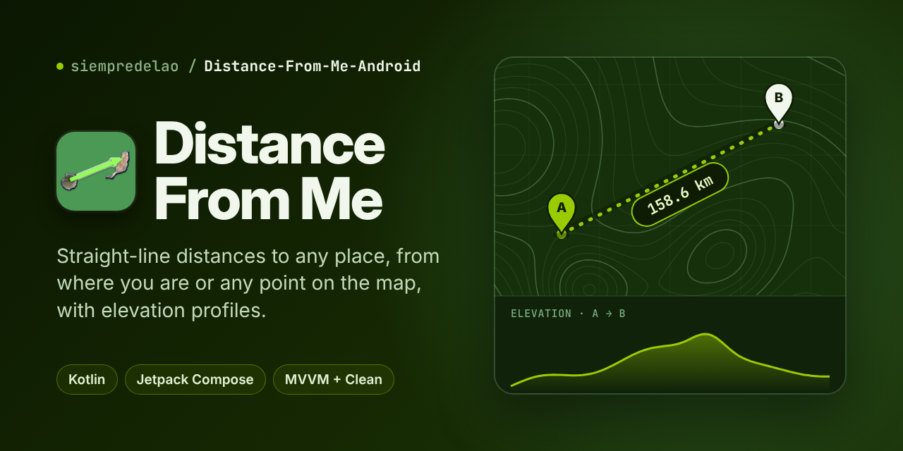

## What is it?
*Distance From Me* is an Android application whose objective is to calculate straight-line distances.
Code is organised by features in a multi-module Gradle project, following MVVM + Clean architecture.

## Features
* Searches places by keyboard and by voice.
* Calculates multi-points distances.
* Calculates distances from current position or from any position.
* Allows to show elevation profile.
* Loads and saves distances.
* Shares distances with friends.
* Shortcut to Play Store to rate app.
* Some FAQ.
* Languages: English, Spanish, French, German, Italian, Portuguese and Catalan.

## Modules
Modules are grouped by role, and each group only depends inwards: features on core and support, core on core and support, support on support. Features never depend on each other. Konsist guards enforce this.

| Module | Description |
|---|---|
| `:app` | Main application module: the map screen, onboarding and the navigator that opens every screen |
| **Features** | |
| `:features:about` | About screen and app information |
| `:features:address` | Address search ViewModel |
| `:features:connectivity` | Connection issues UI |
| `:features:elevation` | Elevation profile feature |
| `:features:faq` | FAQ / Help & Feedback feature |
| `:features:feedback` | In-app review dialog |
| `:features:opensource` | Open source licenses screen |
| `:features:settings` | Settings screen that edits the preferences |
| `:features:show-info` | Distance detail and sharing screen |
| **Core** | |
| `:core:address` | Geocoding and reverse geocoding, with their error messages |
| `:core:coordinates` | Coordinates, distance calculation and the points the map and Show info share (plain Kotlin) |
| `:core:design-system` | Compose theme, shared UI components and the launcher icon |
| `:core:distances` | Room database and distance domain |
| `:core:geocoding` | Google Maps web services client (Geocoding and Elevation APIs) and its API key |
| `:core:settings` | Settings repository (unit system, camera animation and elevation chart preferences) |
| `:core:units` | Unit systems, unit conversion and distance formatting (plain Kotlin) |
| **Support** | |
| `:support:android` | Thin wrappers over the Android framework (resources, connectivity, toasts) |
| `:support:coroutines` | Coroutine error handling and the IO dispatcher |
| `:support:navigation` | Routes and the navigator interface for opening screens in other modules |
| `:support:test` | Shared test utilities |
| **Tools** | |
| `:tools:konsist` | Konsist guards that enforce architecture and code conventions |

Shared Gradle setup lives in the `build-logic/` convention plugins.

## Main libraries used
* [Jetpack Compose](https://developer.android.com/jetpack/compose)
* [Kotlin Coroutines & Flow](https://github.com/Kotlin/kotlinx.coroutines)
* [Koin](https://github.com/InsertKoinIO/koin)
* [Room](https://developer.android.com/topic/libraries/architecture/room)
* [OkHttp](https://square.github.io/okhttp/)
* [kotlinx.serialization](https://github.com/Kotlin/kotlinx.serialization)
* [Material Components](https://github.com/material-components/material-components-android)
* [Lottie](https://github.com/airbnb/lottie-android)
* [Timber](https://github.com/JakeWharton/timber)
* [GraphView](https://github.com/jjoe64/GraphView)
* [LeakCanary](https://github.com/square/leakcanary)
* [Firebase Crashlytics](https://firebase.google.com/docs/crashlytics)
* [Mockito](https://site.mockito.org/)
* [Konsist](https://docs.konsist.lemonappdev.com/)

## Testing

The project has comprehensive test coverage for all critical components:
- **100% file coverage** 🎉 - All ViewModels, Mappers, Repositories, Formatters, and UseCases have unit tests
- **~89% branch coverage** 🟡 - Most code branches (if/when/else) are tested, including the expanded `MainViewModel` flow coverage

For detailed branch coverage analysis, see [BRANCH_COVERAGE_REPORT.md](BRANCH_COVERAGE_REPORT.md).

### Run all unit tests

```bash
# Run all module tests with visual progress feedback
cd /home/david/projects/Distance-From-Me-Android && printf "=== RUNNING ALL UNIT TESTS ===\n\n" && for module in core:address core:coordinates core:distances core:geocoding core:settings core:units features:address features:elevation features:opensource features:settings features:show-info support:android support:coroutines app; do printf "📦 Testing: %s\n" "$module"; ./gradlew :"$module":testDebugUnitTest --quiet 2>&1 > /dev/null && printf "✅ PASSED\n\n" || printf "❌ FAILED\n\n"; done && printf "=== TESTS COMPLETED ===\n"

# Or run tests for all modules at once (debug variant; plain Kotlin modules run their `test` task)
./gradlew testDebugUnitTest

# Run tests for specific module
./gradlew :core:address:testDebugUnitTest
./gradlew :core:coordinates:test
./gradlew :core:distances:testDebugUnitTest
./gradlew :core:geocoding:testDebugUnitTest
./gradlew :core:settings:testDebugUnitTest
./gradlew :core:units:test
./gradlew :features:address:testDebugUnitTest
./gradlew :features:elevation:testDebugUnitTest
./gradlew :features:opensource:testDebugUnitTest
./gradlew :features:settings:testDebugUnitTest
./gradlew :features:show-info:testDebugUnitTest
./gradlew :support:android:testDebugUnitTest
./gradlew :support:coroutines:testDebugUnitTest
./gradlew :app:testDebugUnitTest

# Run the Konsist architecture and convention guards
./gradlew :tools:konsist:test
```

### Test Coverage Summary

#### File Coverage (All classes have tests)
- ✅ **UseCases**: 100% (9/9)
- ✅ **Mappers**: 100% (12/12)
- ✅ **Formatters**: 100% (1/1)
- ✅ **ViewModels**: 100% (8/8)
- ✅ **Repositories**: 100% (8/8)

#### Branch Coverage (Code paths tested)
- ✅ **UseCases**: ~100% - All if/when branches covered
- ✅ **Repositories**: ~100% - All if/when branches covered
- ✅ **Formatters**: ~100% - All formatting paths covered
- ✅ **Mappers**: ~98% - Almost all branches covered
- ✅ **ViewModels**: ~83% - Main application flows and edge cases are now well covered
 
**Overall**: 100% file coverage, ~89% branch coverage. See detailed analysis in [BRANCH_COVERAGE_REPORT.md](BRANCH_COVERAGE_REPORT.md).

## Contributions
Contributions are welcome. Please read the [contributions guide](CONTRIBUTING.md) for more information. 

## Download
[](https://play.google.com/store/apps/details?id=gc.david.dfm)

## License
```
   Copyright (c) 2026 David Aguiar Gonzalez

   Licensed under the Apache License, Version 2.0 (the "License");
   you may not use this file except in compliance with the License.
   You may obtain a copy of the License at

       http://www.apache.org/licenses/LICENSE-2.0

   Unless required by applicable law or agreed to in writing, software
   distributed under the License is distributed on an "AS IS" BASIS,
   WITHOUT WARRANTIES OR CONDITIONS OF ANY KIND, either express or implied.
   See the License for the specific language governing permissions and
   limitations under the License.
```